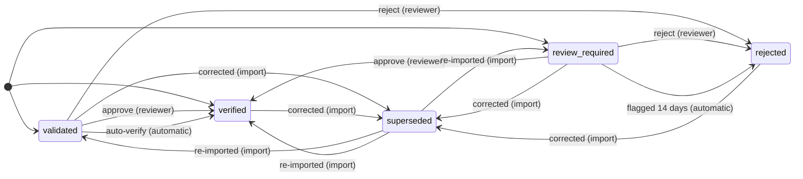
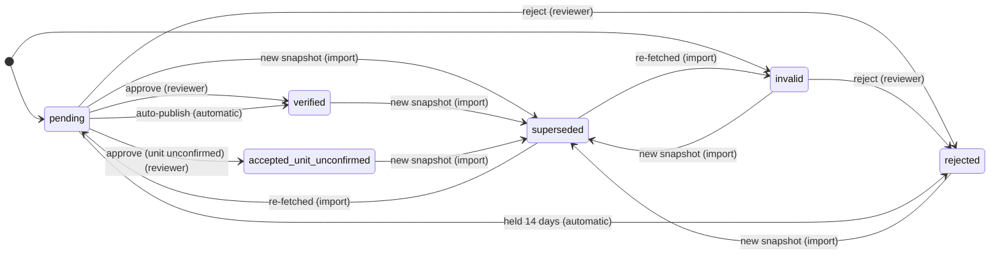
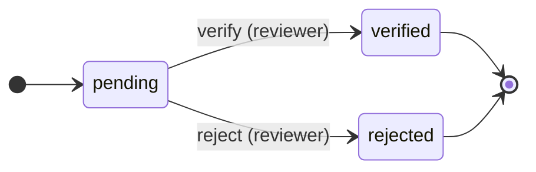
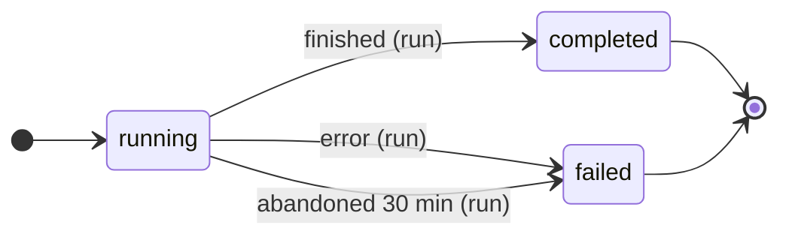
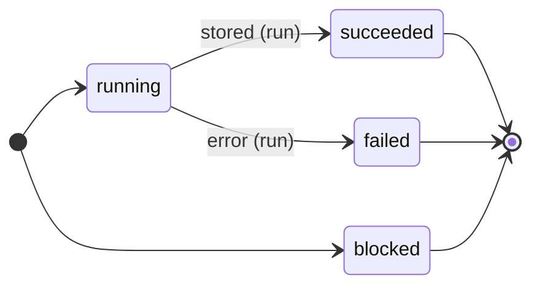
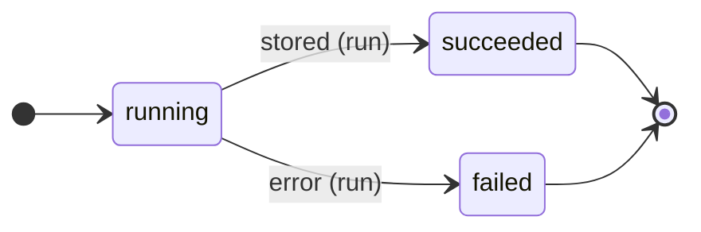
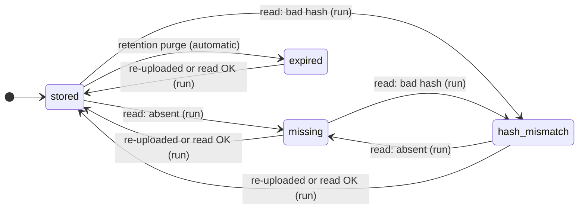
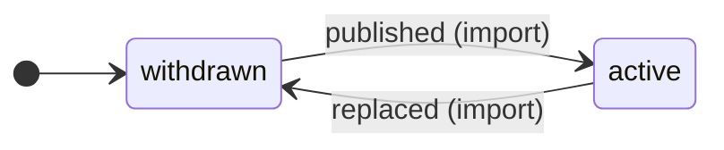
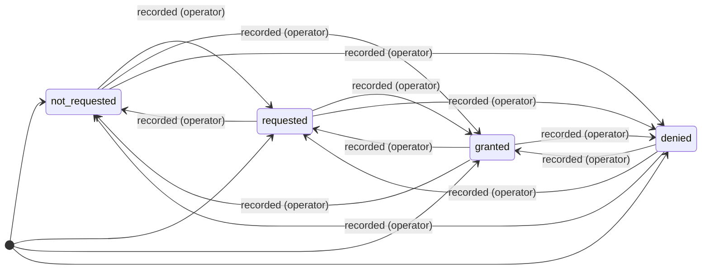
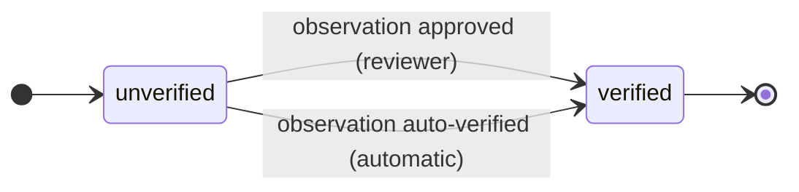

# Record lifecycles

<!-- Generated from shared/lifecycles.ts by `npm run docs:lifecycles`. Do not edit by hand. -->

Each status column below changes only along the transitions listed. `shared/lifecycles.ts` is the source of truth;
`api/src/lifecycles.test.ts` checks it against the migrated schema (the CHECK constraints) and against every literal
status write in `api/src`, and fails when this page is out of date.

Every transition is written as a guarded update (`... WHERE id = ? AND status = '<from>'`), so two reviewers, or a
reviewer and an automatic pass, cannot both move one record. The second is refused, and the response names the
record's state now (`current_status`).

Actors: **reviewer**, a person with the reviewer token; **automation**, scheduled checks; **import**, connector and
upload writes; **operator**, configuration by an administrator; **system**, run bookkeeping.

## observation: `market_price_observations.validation_status`

An official (AGMARKNET or CSV) price row, from import to publication. Only `verified` rows reach readers.

| State | Role | Meaning |
|---|---|---|
| `validated` | start | Passed every connector check; waiting for review or automatic verification. |
| `review_required` | start | The connector flagged it (for example an implausible range); waiting for a person. |
| `verified` | start | Published in prices and analytics. |
| `rejected` |  | Kept for audit, never published. |
| `superseded` |  | Replaced by a corrected version of the same source record. |

| From | To | Event | By | Note |
|---|---|---|---|---|
| `validated`, `review_required` | `verified` | approve | reviewer |  |
| `validated` | `verified` | auto-verify | automation | AGMARKNET_DAILY_AUTO_VERIFY; api/src/auto-verify.ts |
| `validated`, `review_required` | `rejected` | reject | reviewer |  |
| `review_required` | `rejected` | flagged 14 days | automation |  |
| `validated`, `review_required`, `verified`, `rejected` | `superseded` | corrected | import |  |
| `superseded` | `validated` | re-imported | import |  |
| `superseded` | `review_required` | re-imported | import |  |
| `superseded` | `verified` | re-imported | import | History import with AGMARKNET_HISTORY_AUTO_VERIFY |

## cooperativeQuote: `cooperative_quotes.status`

A cooperative (MAMCOS, TSS, TMS, TUMCOS) branch average. Only `verified` rows reach readers.

| State | Role | Meaning |
|---|---|---|
| `pending` | start | Stored and waiting for automatic publication or a person. |
| `invalid` | start | Failed source validation; can only be rejected. |
| `verified` |  | Published. |
| `accepted_unit_unconfirmed` |  | Accepted as a source record, but not published because its unit is unconfirmed. |
| `rejected` |  | Kept for audit, never published. |
| `superseded` |  | Replaced by a newer snapshot of the same source record. |

**Sub-state `held`:** pending with hold_reason set: automatic checks found a problem (held_at is when). A person can still approve or reject it; otherwise it is rejected automatically 14 days after held_at.

| From | To | Event | By | Note |
|---|---|---|---|---|
| `pending` | `verified` | approve | reviewer |  |
| `pending` | `verified` | auto-publish | automation | api/src/cooperative-auto-publish.ts |
| `pending` | `accepted_unit_unconfirmed` | approve (unit unconfirmed) | reviewer |  |
| `pending`, `invalid` | `rejected` | reject | reviewer |  |
| `pending` | `rejected` | held 14 days | automation |  |
| `pending`, `invalid`, `verified`, `accepted_unit_unconfirmed`, `rejected` | `superseded` | new snapshot | import |  |
| `superseded` | `pending` | re-fetched | import |  |
| `superseded` | `invalid` | re-fetched | import |  |

## cropFieldReport: `crop_field_reports.verification_status`

A field observation of crop disease or pests, reviewed before it informs risk advisories.

| State | Role | Meaning |
|---|---|---|
| `pending` | start | Submitted; waiting for a reviewer. |
| `verified` | final | Accepted as evidence. |
| `rejected` | final | Kept, not used. |

| From | To | Event | By | Note |
|---|---|---|---|---|
| `pending` | `verified` | verify | reviewer |  |
| `pending` | `rejected` | reject | reviewer |  |

## qualityInspection: `quality_inspections.status`

A laboratory quality report for a lot, reviewed before use.

| State | Role | Meaning |
|---|---|---|
| `pending` | start | Submitted; waiting for a reviewer. |
| `verified` | final | Accepted. |
| `rejected` | final | Kept, not used. |
| `superseded` | final, unreachable | Reserved for a corrected report. A correction is currently submitted as a separate report instead. |

| From | To | Event | By | Note |
|---|---|---|---|---|
| `pending` | `verified` | verify | reviewer |  |
| `pending` | `rejected` | reject | reviewer |  |

## ingestionJob: `ingestion_jobs.status`

One official import request (POST /admin/import, /admin/agmarknet/history/import).

| State | Role | Meaning |
|---|---|---|
| `running` | start | Writing rows. |
| `completed` | final | Finished; counts recorded. |
| `failed` | final | Stopped; error_message says why. |

**Abandoned runs:** a row still `running` after 30 minutes was abandoned. A retry with the same idempotency key marks the abandoned job failed and runs the import again.

| From | To | Event | By | Note |
|---|---|---|---|---|
| `running` | `completed` | finished | system |  |
| `running` | `failed` | error | system |  |
| `running` | `failed` | abandoned 30 min | system | Released by a retry with the same idempotency key |

## cooperativeFetch: `cooperative_fetches.status`

One collection from a cooperative website, with its raw snapshot.

| State | Role | Meaning |
|---|---|---|
| `running` | start | Fetching and storing. |
| `succeeded` | final | Snapshot stored. |
| `failed` | final | Fetch or parse failed; earlier records were kept. |
| `blocked` | start, final | Not attempted: collection permission is not recorded as granted. |

**Abandoned runs:** a row still `running` after 30 minutes was abandoned. Source status reports availability "stalled" instead of "running"; the row is left as recorded.

| From | To | Event | By | Note |
|---|---|---|---|---|
| `running` | `succeeded` | stored | system |  |
| `running` | `failed` | error | system |  |

## monthlyRefreshRun: `monthly_refresh_runs.status`

One download of the Karnataka monthly price report.

| State | Role | Meaning |
|---|---|---|
| `running` | start | Downloading. |
| `succeeded` | final | Report stored. |
| `failed` | final | Download or parse failed. |

| From | To | Event | By | Note |
|---|---|---|---|---|
| `running` | `succeeded` | stored | system |  |
| `running` | `failed` | error | system |  |

## intelligenceRefreshRun: `intelligence_refresh_runs.status`

One refresh of an intelligence source (weather, official bulletins).

| State | Role | Meaning |
|---|---|---|
| `running` | start | Fetching. |
| `succeeded` | final | Capture stored. |
| `failed` | final | Fetch failed. |

| From | To | Event | By | Note |
|---|---|---|---|---|
| `running` | `succeeded` | stored | system |  |
| `running` | `failed` | error | system |  |

## archiveObject: `archive_objects.status`

An evidence or temporary object in the R2 archive, re-checked by SHA-256 whenever it is read.

| State | Role | Meaning |
|---|---|---|
| `stored` | start | Present, and its hash matched when last checked. |
| `missing` |  | Not found in R2 when last read. |
| `hash_mismatch` |  | Found, but its SHA-256 did not match. |
| `expired` |  | Temporary object past its retention; bytes deleted. |

| From | To | Event | By | Note |
|---|---|---|---|---|
| `stored`, `hash_mismatch` | `missing` | read: absent | system |  |
| `stored`, `missing` | `hash_mismatch` | read: bad hash | system |  |
| `missing`, `hash_mismatch`, `expired` | `stored` | re-uploaded or read OK | system |  |
| `stored` | `expired` | retention purge | automation |  |

## assistantDocument: `documents.status`

A document in the assistant's search index. Only `active` documents are searched.

| State | Role | Meaning |
|---|---|---|
| `active` |  | Searchable. |
| `withdrawn` | start | Not searchable: either still being written (a new upload) or replaced by a newer version. |

| From | To | Event | By | Note |
|---|---|---|---|---|
| `withdrawn` | `active` | published | import | Chunks are written first, then one batch publishes |
| `active` | `withdrawn` | replaced | import |  |

## cooperativePermission: `cooperative_sources.permission_status`

Whether a cooperative has permitted collection. Scheduled collection needs `granted` and its own flag.

| State | Role | Meaning |
|---|---|---|
| `not_requested` | start | No request made. |
| `requested` | start | Requested; no answer recorded. |
| `granted` | start | Granted; a permission reference is required. |
| `denied` | start | Refused; collection and redistribution are off. |

| From | To | Event | By | Note |
|---|---|---|---|---|
| `requested`, `granted`, `denied` | `not_requested` | recorded | operator |  |
| `not_requested`, `granted`, `denied` | `requested` | recorded | operator |  |
| `not_requested`, `requested`, `denied` | `granted` | recorded | operator | Needs permission_reference |
| `not_requested`, `requested`, `granted` | `denied` | recorded | operator |  |

## marketMapping: `markets.mapping_status`

Whether a market's name and district have been confirmed by an approved observation.

| State | Role | Meaning |
|---|---|---|
| `unverified` | start | Seen in an import only. |
| `verified` | final | Confirmed by an approved observation. |

| From | To | Event | By | Note |
|---|---|---|---|---|
| `unverified` | `verified` | observation approved | reviewer |  |
| `unverified` | `verified` | observation auto-verified | automation |  |
